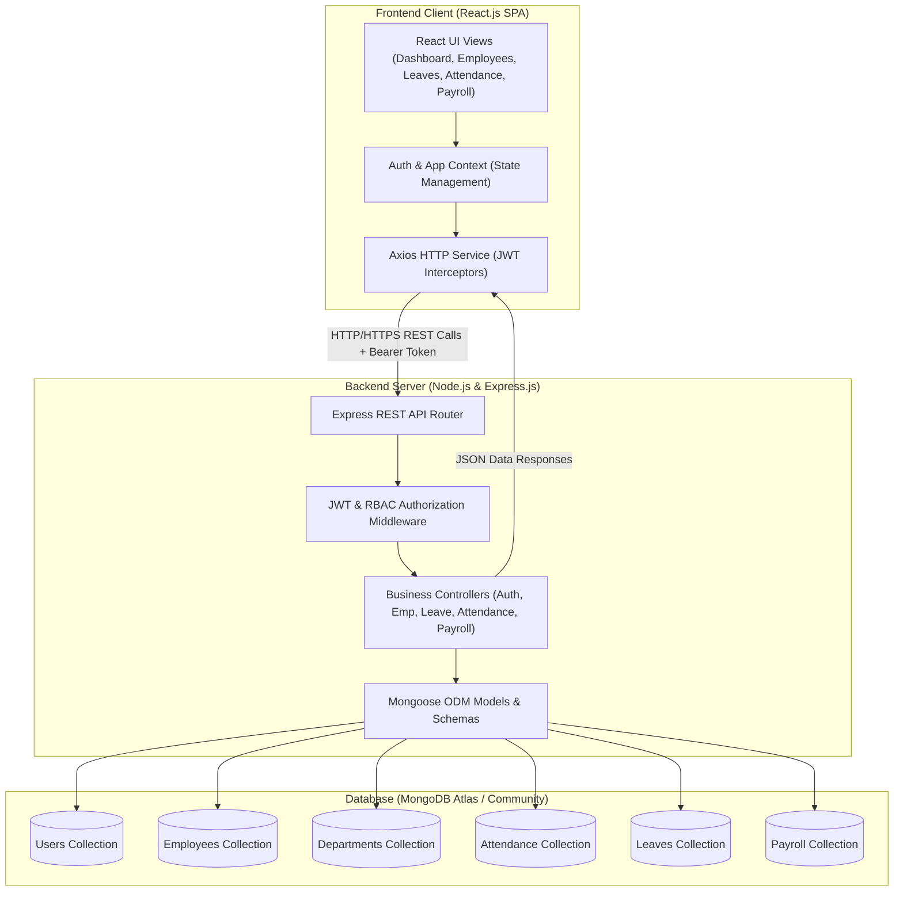
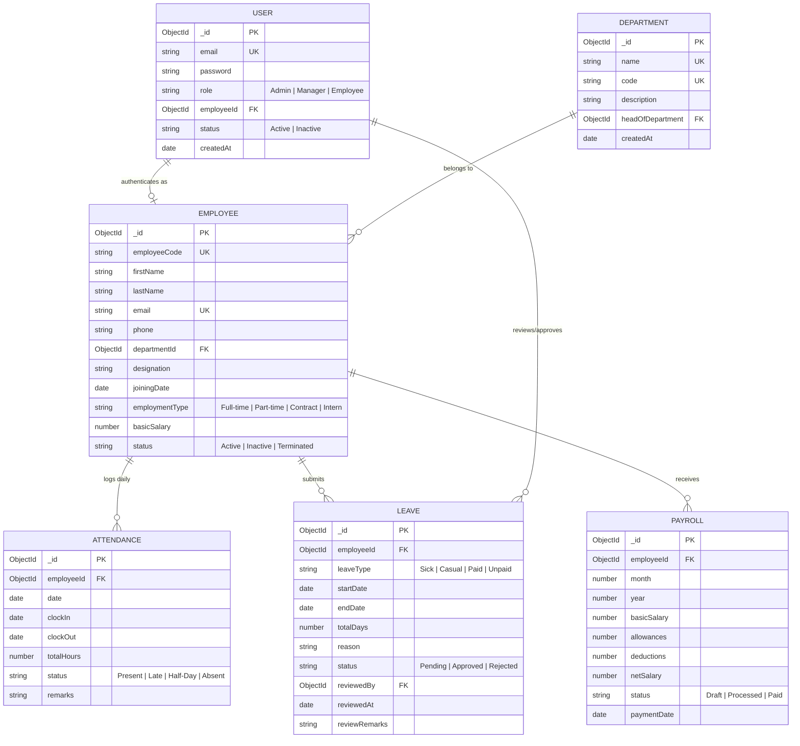
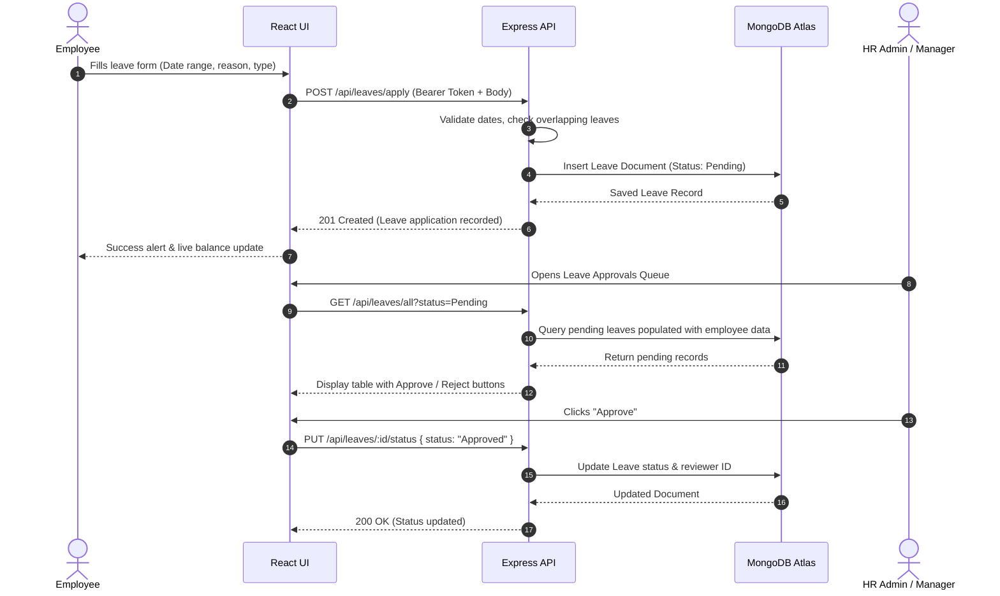

# StaffSync — Project Design & Architecture (Phase 3)
**Project Score Weightage: 15 Marks**

---

## 1. System Architecture Overview
StaffSync follows a decoupled 3-tier MERN architecture:
- **Presentation Layer (Frontend)**: React.js SPA utilizing component-based architecture, React Router DOM for client-side routing, Context API for state management, and Axios for asynchronous API communication.
- **Application Layer (Backend)**: Node.js with Express.js providing a RESTful API gateway, route-level authorization middleware, input validators, and business controllers.
- **Data Persistence Layer (Database)**: MongoDB NoSQL document store accessed through Mongoose Object Data Modeling (ODM) with schema validation, indexes, and relational population.

---

## 2. Database Schema Design (Mongoose Models)

### 2.1 Entity Relationship Model

---

## 3. RESTful API Specification

### Authentication Endpoints (`/api/auth`)
| Method | Endpoint | Access | Description | Request Body | Response |
| :--- | :--- | :--- | :--- | :--- | :--- |
| `POST` | `/login` | Public | Authenticates credentials and returns JWT token | `{ email, password }` | `{ token, user }` |
| `POST` | `/register` | Admin | Creates a system user account | `{ email, password, role, employeeId }` | `{ success, user }` |
| `GET` | `/me` | Authenticated | Fetches current logged-in user profile | None (Bearer Token) | `{ user }` |
| `PUT` | `/update-password` | Authenticated | Updates current user password | `{ currentPassword, newPassword }` | `{ message }` |

### Employee Management Endpoints (`/api/employees`)
| Method | Endpoint | Access | Description |
| :--- | :--- | :--- | :--- |
| `GET` | `/` | Admin, Manager | Fetch all employees with filters (search, department, status) |
| `GET` | `/:id` | Authenticated | Get detailed profile of an employee |
| `POST` | `/` | Admin, Manager | Onboard a new employee |
| `PUT` | `/:id` | Admin, Manager | Update employee details |
| `DELETE` | `/:id` | Admin | Soft-delete / deactivate employee |

### Department Endpoints (`/api/departments`)
| Method | Endpoint | Access | Description |
| :--- | :--- | :--- | :--- |
| `GET` | `/` | Authenticated | List all departments with manager and member count |
| `POST` | `/` | Admin | Create a new department |
| `PUT` | `/:id` | Admin | Update department details |
| `DELETE` | `/:id` | Admin | Delete an empty department |

### Attendance Endpoints (`/api/attendance`)
| Method | Endpoint | Access | Description |
| :--- | :--- | :--- | :--- |
| `POST` | `/clock-in` | Employee, Manager | Clock in for the current day |
| `POST` | `/clock-out` | Employee, Manager | Clock out and calculate total working hours |
| `GET` | `/today` | Authenticated | Get today's attendance record for current user |
| `GET` | `/history` | Authenticated | Get logged-in user's attendance history |
| `GET` | `/all` | Admin, Manager | Get all employees' attendance for a given date |

### Leave Endpoints (`/api/leaves`)
| Method | Endpoint | Access | Description |
| :--- | :--- | :--- | :--- |
| `POST` | `/apply` | Authenticated | Submit a new leave request |
| `GET` | `/my-leaves` | Authenticated | View current user's submitted leave requests |
| `GET` | `/all` | Admin, Manager | View all leave requests across the company |
| `PUT` | `/:id/status`| Admin, Manager | Approve or reject a leave request with comments |

### Payroll Endpoints (`/api/payroll`)
| Method | Endpoint | Access | Description |
| :--- | :--- | :--- | :--- |
| `POST` | `/generate` | Admin | Generate monthly payroll records for all active employees |
| `GET` | `/month` | Admin | Get payroll summary for a specific month/year |
| `GET` | `/my-payslips`| Authenticated | Get logged-in employee's payslip history |
| `PUT` | `/:id/status`| Admin | Update payroll status (Draft -> Processed -> Paid) |

### Dashboard Analytics (`/api/dashboard`)
| Method | Endpoint | Access | Description |
| :--- | :--- | :--- | :--- |
| `GET` | `/stats` | Authenticated | Get aggregate counts (headcount, attendance %, pending leaves, payroll total) |

---

## 4. Key Workflows & Sequence Diagrams

### 4.1 Leave Application & Review Sequence

